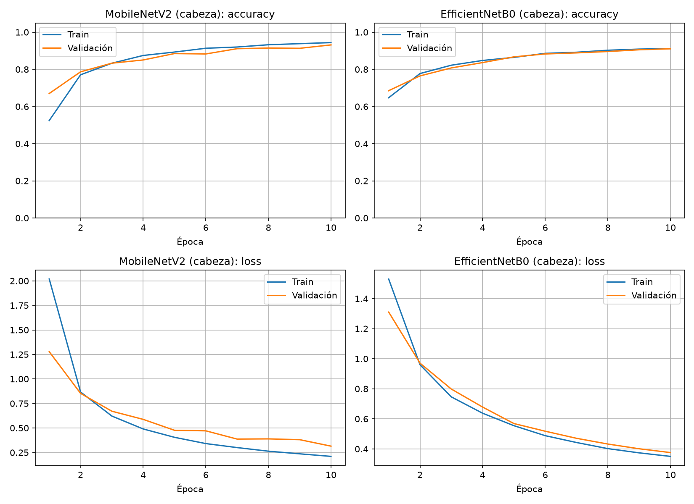
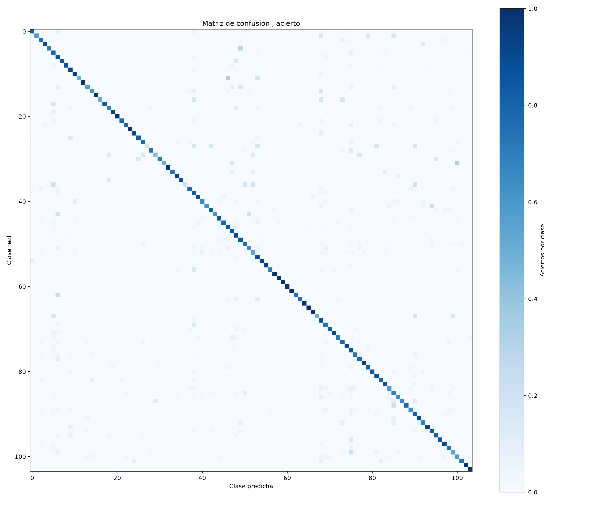

# Clasificación de flores con Transfer Learning

Tarea 6 de Temas Selectos de Aprendizaje Profundo (TL): clasificar un dataset grande (muchas clases, muchos datos) con transferencia de aprendizaje, entrenando en el cluster YUCA y llevando el modelo a una aplicación web que corre en el celular.

- **Dataset:** [Flower Classification with TPUs](https://www.kaggle.com/competitions/tpu-getting-started) (Kaggle), versión JPG: 104 clases, 12 753 imágenes de entrenamiento y 3 712 de prueba.
- **Redes base (ImageNet):** MobileNetV2 y EfficientNetB0, ambas con entrada de 160×160.
- **Cabeza:** `GlobalAveragePooling2D → Dropout(0.2) → Dense(104, softmax)`.

## Resultados

| Modelo | Estrategia | Accuracy en prueba |
|---|---|---|
| MobileNetV2 | 10 épocas de cabeza (lr 1e-3) + 40 de fine-tuning desde la capa 130 (lr 1e-5) | **0.8182** |
| EfficientNetB0 | 10 épocas de cabeza (lr 1e-3) + 30 de fine-tuning de las últimas 40 capas, BatchNorm congelada (lr 1e-5) | **0.8556** |

Con la base congelada y lr 1e-5 desde el inicio, EfficientNetB0 solo alcanzó 0.5585, así que la fase de cabeza con lr 1e-3 fue clave.




## Estructura

```
entrenar_flores.py     Entrenamiento de los dos modelos y generación de gráficas
script.slrm            Trabajo SLURM para el cluster YUCA
graficar_log.py        Gráfica de accuracy y loss por época a partir del log de SLURM
entorno_yml/           Ambiente de conda exportado (cofee311.yml)
resultados_*.txt       Salida del entrenamiento en YUCA
graficas/              acc_loss.png, matriz.png
pruebas_modelos/       Predicciones de muestra de cada modelo
modelos/               Modelos convertidos a TensorFlow.js
pagina_web/            Aplicación web (Vite + TensorFlow.js)
```

## Entrenar en YUCA

```bash
conda env create -f entorno_yml/cofee311.yml     # o: conda activate coffe311
sbatch script.slrm                                # salida en resultados_<jobid>.txt
conda env export -n coffe311 > cofee311.yml       # ambiente final
python graficar_log.py resultados_<jobid>.txt     # gráficas desde el log
```

El script espera el dataset en `flowers_jpg/train` y `flowers_jpg/val`, y guarda los modelos H5 en `modelos/`. Para usarlos en el navegador se convierten con `tensorflowjs_converter`.

## Aplicación web

Corre 100 % en el navegador (TensorFlow.js): se sube una foto o se usa la cámara y se elige entre MobileNetV2 y EfficientNetB0.

```bash
cd pagina_web
npm install
npm run dev      # desarrollo
npm run build    # genera dist/ para publicar
```

> La cámara requiere **HTTPS** (o `localhost`). Para probar en el celular, publica `dist/` en GitHub Pages, Netlify o Vercel.

## Artículo
- Medium:https://medium.com/@sebastianalcantar323/clasificacion-de-104-tipos-de-flores-usando-transfer-learning-83c2ed6012f3?sharedUserId=sebastianalcantar323
