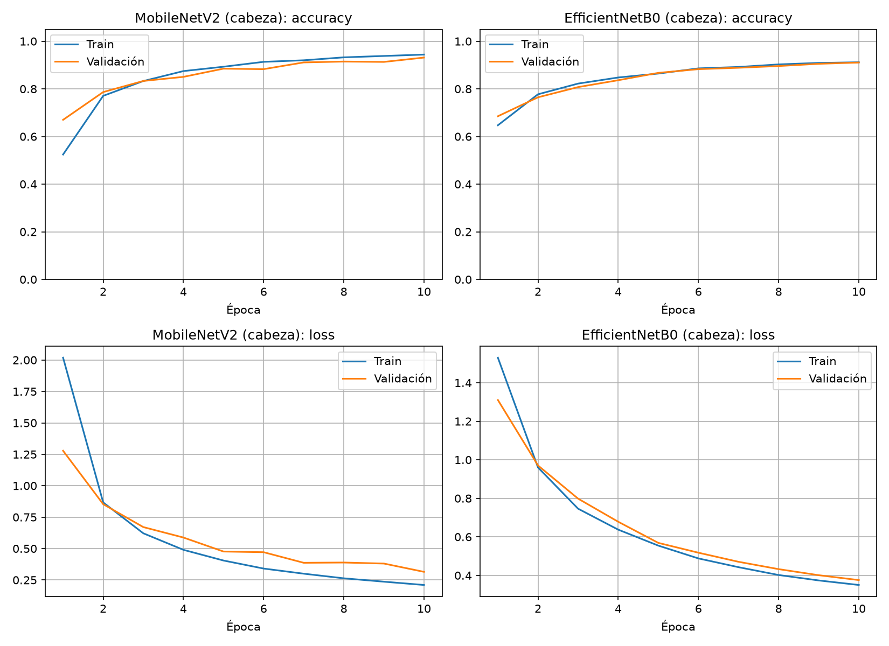
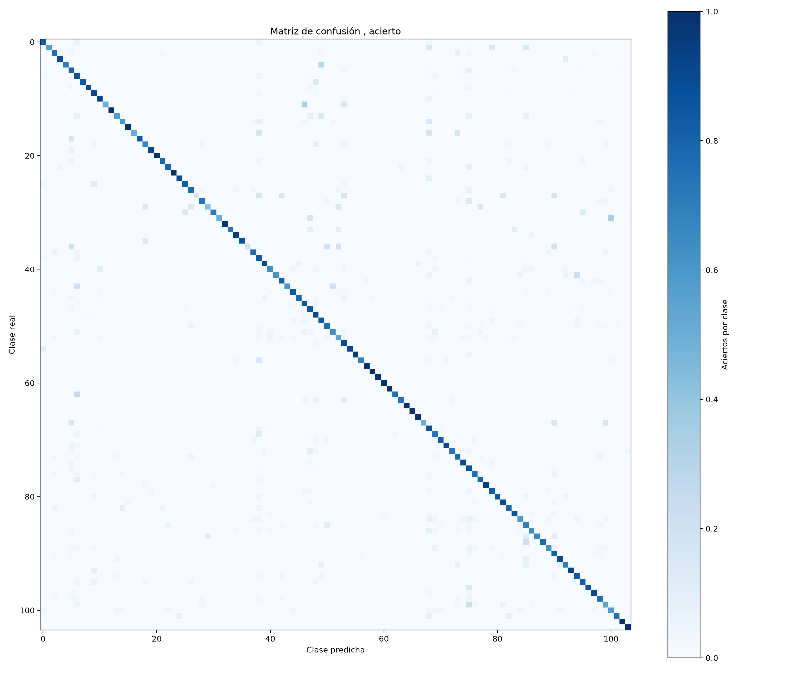

# Clasificando 104 tipos de flores con Transfer Learning (y llevándolo al celular)

Entrenar una red desde cero para reconocer 104 clases de flores con unas 12 mil imágenes es pedirle demasiado: hay pocas imágenes por clase. La transferencia de aprendizaje resuelve eso reutilizando lo que una red ya aprendió en ImageNet. En este artículo cuento cómo entrené dos modelos en el cluster YUCA y los llevé a una página web que funciona en el celular.

Código: https://github.com/SebastianAlcantarr/Clasificacion_Flores_TL

## El dataset
Usé el de Kaggle "Flower Classification with TPUs" en su versión JPG: 104 clases, 12 753 imágenes de entrenamiento y 3 712 de prueba. Separé 15 % del entrenamiento para validación (10 841 / 1 912) y redimensioné todo a 160×160.

## La idea
Una red preentrenada ya sabe detectar bordes, texturas y formas. Congelo esa "base", le pongo una cabeza nueva (`GlobalAveragePooling2D → Dropout(0.2) → Dense(104, softmax)`) y la entreno para mis clases. Después hago fine-tuning: descongelo las últimas capas de la base y entreno con una tasa de aprendizaje muy baja.

## Dos modelos
**MobileNetV2:** 10 épocas con la base congelada (Adam 1e-3) y 40 de fine-tuning desde la capa 130 (Adam 1e-5). Accuracy en prueba: **81.8 %**.

**EfficientNetB0:** mi primer intento, con la base congelada y lr 1e-5, quedó en 55.9 %, porque la cabeza nueva necesita una tasa mayor para aprender. Reentrené la cabeza 10 épocas con lr 1e-3 y luego afiné las últimas 40 capas dejando las BatchNormalization congeladas (EfficientNet es sensible a eso). Resultado: **85.6 %**.

En la matriz de confusión se ve que casi todas las clases se reconocen bien, y que fallan sobre todo las clases poco representadas o muy parecidas entre sí (las peores fueron las clases 3, 38, 31, 15 y 33).

## Entrenar en YUCA
Creé un ambiente de conda, lo activé dentro de un script SLURM y lancé el trabajo con `sbatch script.slrm`. Al terminar exporté el ambiente con `conda env export -n coffe311 > cofee311.yml` para que cualquiera pueda reproducirlo.

## Llevarlo al celular
Convertí los modelos con `tensorflowjs_converter` y armé una página con TensorFlow.js: todo corre en el navegador, sin servidor. Eligo el modelo, tomo una foto con la cámara (requiere HTTPS) y la red devuelve la flor más probable.

[VIDEO / CAPTURAS DE LA APP EN EL CELULAR]

## Aprendizajes
- Con muchas clases y pocos datos por clase, el transfer learning rinde mucho más que entrenar desde cero.
- Entrenar primero la cabeza y después hacer fine-tuning con lr bajo marca la diferencia (55.9 % → 85.6 % en EfficientNetB0).
- Revisa qué capas congelas: las BatchNormalization merecen cuidado especial.

Repositorio: https://github.com/SebastianAlcantarr/Clasificacion_Flores_TL
